# Ngantriin

**Good Food • Less Wait • Happier You**

## Deskripsi Aplikasi

Ngantriin adalah aplikasi Android yang membantu pengguna menemukan restoran, mengambil nomor antrean secara digital, serta memantau perkembangan antrean tanpa harus menunggu di lokasi sejak awal. Aplikasi menyediakan informasi outlet, jumlah antrean, dan estimasi waktu tunggu. Pengguna juga menerima notifikasi saat giliran mendekat, melakukan check-in ketika tiba di restoran, melihat riwayat antrean, serta memberikan penilaian dan ulasan.

Di sisi restoran, staf dapat mengelola antrean melalui dashboard, memanggil pelanggan berikutnya, memperbarui status tiket, dan memeriksa foto check-in. Dengan informasi restoran dan pengelolaan antrean dalam satu aplikasi, Ngantriin bertujuan membuat proses menunggu lebih praktis, terorganisasi, dan nyaman.

## Video Demo

▶ **[Tonton Video Demo Ngantriin di Google Drive](https://drive.google.com/file/d/1sxTP8jGzjPeeZGZPBCGBieA_eKFkm0ue/view?usp=drivesdk)**

> Jika video tidak dapat dibuka, pastikan izin berbagi Google Drive telah diatur agar orang yang memiliki tautan dapat melihatnya.

## Fitur Utama

### Pelanggan

- **Cari restoran:** melihat dan mencari outlet, termasuk informasi detail restoran.
- **Informasi antrean:** melihat jumlah antrean, nomor yang sedang dilayani, dan estimasi waktu tunggu.
- **Ambil antrean digital:** bergabung ke antrean melalui aplikasi tanpa harus langsung menunggu di lokasi.
- **Pantau antrean:** mengikuti perubahan posisi dan status antrean.
- **Notifikasi:** menerima pemberitahuan ketika giliran mendekat atau meja siap.
- **Check-in dengan foto:** mengonfirmasi kehadiran di restoran setelah dipanggil.
- **Riwayat dan ulasan:** melihat riwayat antrean serta memberikan rating dan ulasan setelah kunjungan.
- **Restoran favorit:** menyimpan restoran favorit agar lebih mudah ditemukan kembali.

### Staf Restoran

- **Mendaftarkan restoran:** saat membuat akun pilih "Staf restoran", lalu isi nama, alamat, kategori, foto, lokasi, jam buka, pengaturan antrean, kontak, dan unggah dokumen usaha. Status pengajuan: *Pending Verification*, *Approved*, atau *Rejected* (dengan alasan dan opsi ajukan ulang). Akses staf dan tampil di pencarian baru aktif setelah *Approved*; pendaftar otomatis terhubung hanya dengan restoran yang ia daftarkan.
- **Mengaktifkan / menjeda restoran:** restoran yang dijeda hilang dari pencarian dan tidak menerima tiket baru (tiket yang sudah ada tetap berjalan).
- Staf hanya dapat mengelola antrean restoran miliknya sendiri.
- Melihat ringkasan antrean melalui dashboard.
- Memanggil antrean berikutnya dan mencari nomor tiket.
- Memperbarui status antrean, termasuk saat pelanggan datang, meja siap, dan kunjungan selesai.
- Memeriksa foto check-in pelanggan.

## Teknologi yang Digunakan

- **Bahasa dan UI:** Kotlin, Jetpack Compose
- **Arsitektur:** Model–View–ViewModel (MVVM)
- **Backend dan database:** Supabase
- **Penyimpanan lokal:** Room
- **Pekerjaan terjadwal dan sinkronisasi:** WorkManager
- **Push notification:** Firebase Cloud Messaging (FCM)

## Tampilan Aplikasi

### Pelanggan

<table width="100%">
  <tr>
    <th width="33%">Onboarding</th>
    <th width="33%">Login</th>
    <th width="33%">Beranda</th>
  </tr>
  <tr align="center">
    <td>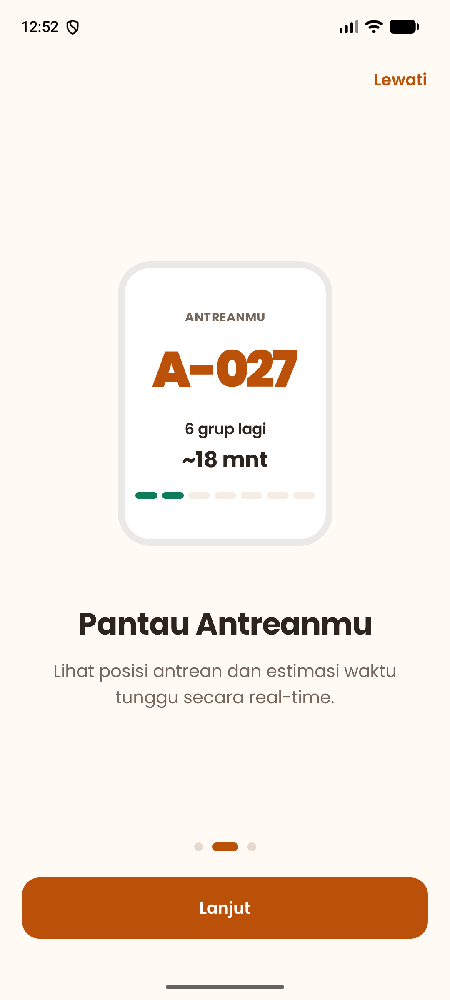</td>
    <td>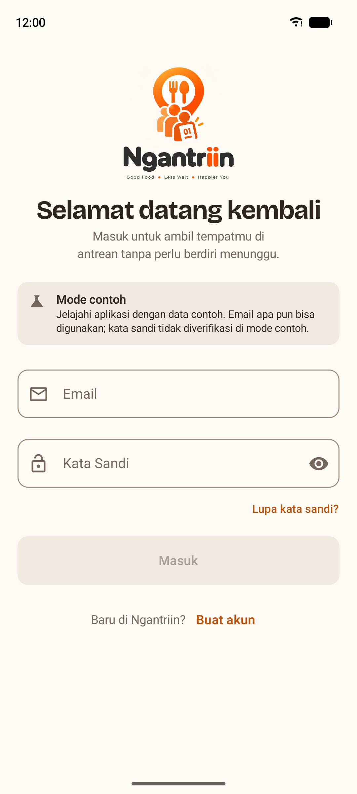</td>
    <td>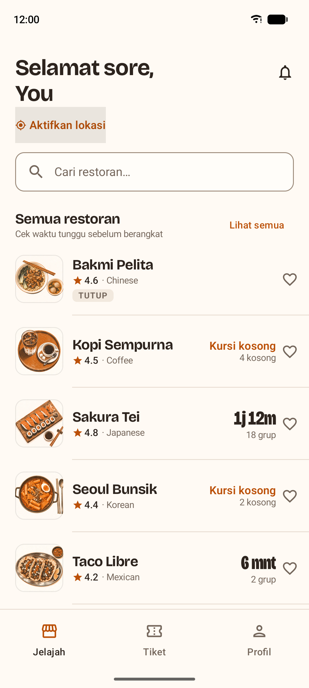</td>
  </tr>
  <tr align="center">
    <td>Pengenalan cara kerja aplikasi</td>
    <td>Masuk atau membuat akun</td>
    <td>Daftar restoran dan informasi antrean</td>
  </tr>
</table>

| Pencarian Restoran | Detail Restoran | Berhasil Antre |
| :---: | :---: | :---: |
| 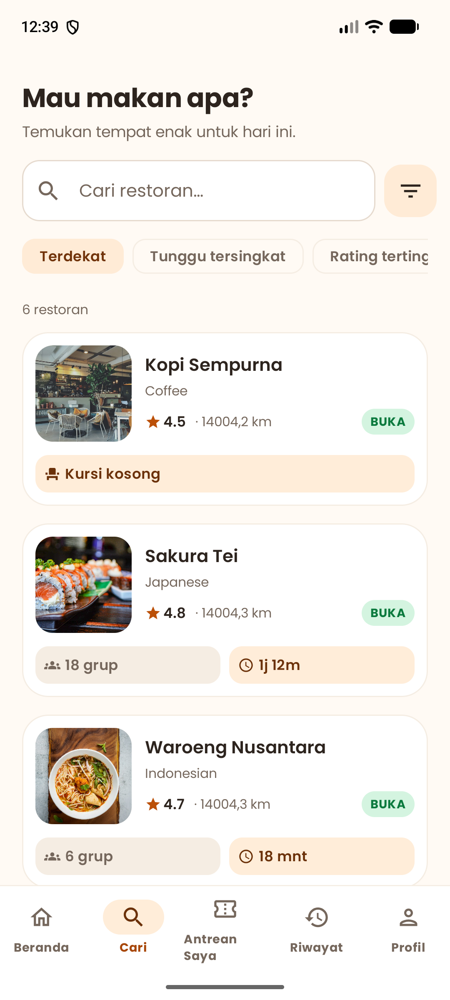 | 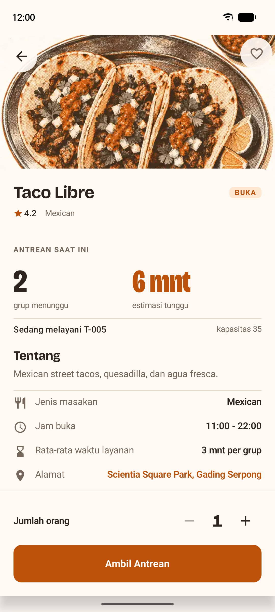 | 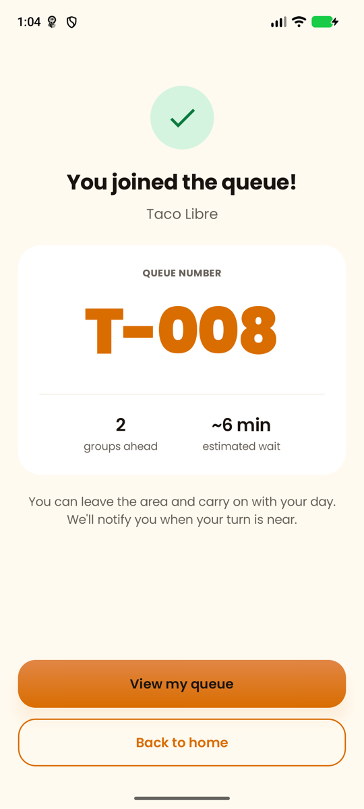 |
| Mencari dan mengurutkan restoran | Informasi outlet dan antrean | Nomor antrean dan estimasi tunggu |

| Antrean Saya | Notifikasi | Profil |
| :---: | :---: | :---: |
| 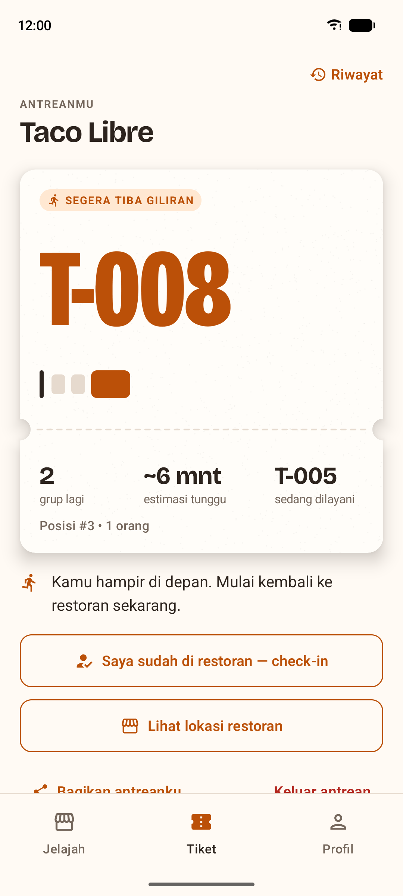 | 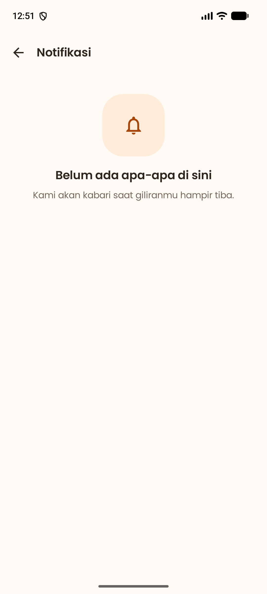 | 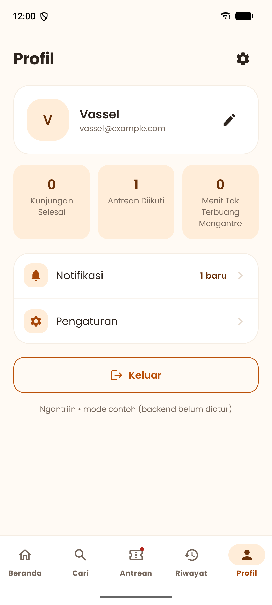 |
| Status dan perkembangan antrean | Pengingat giliran | Informasi dan pengaturan akun |

| Favorit di Beranda | Pencarian Favorit |
| :---: | :---: |
| 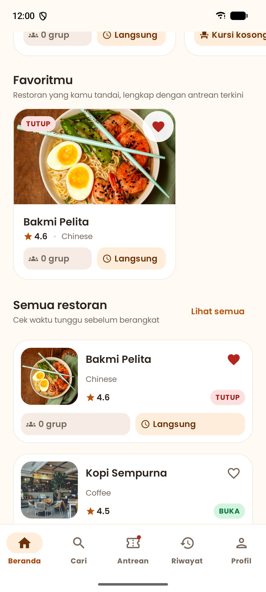 | 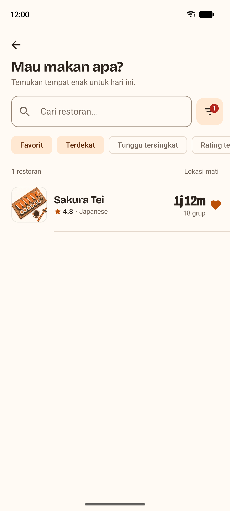 |
| Akses ke restoran yang disimpan | Menyaring daftar restoran favorit |

### Staf Restoran

| Dashboard Staf | Kelola Antrean |
| :---: | :---: |
| 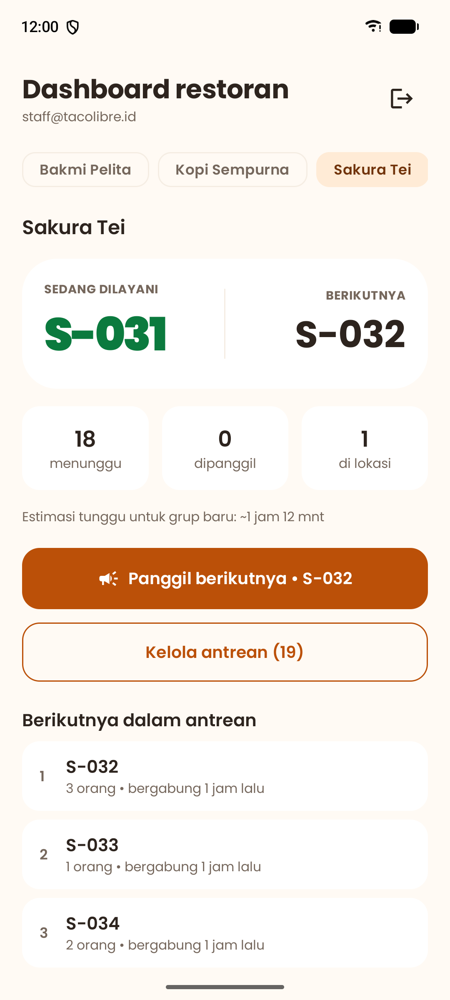 | 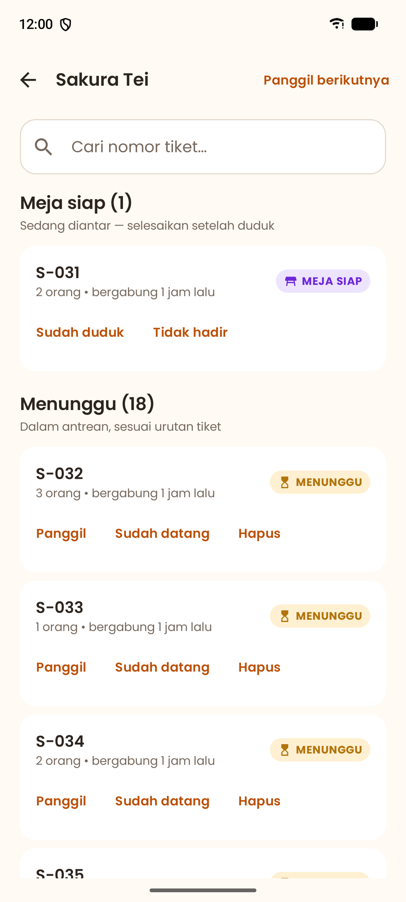 |
| Ringkasan dan antrean berikutnya | Memanggil serta memperbarui status tiket |

## Cara Menjalankan

Jalankan perintah berikut dari direktori utama proyek:

```bash
./gradlew :app:installDebug
```

**Kebutuhan:** JDK 17+, Android SDK, serta emulator atau perangkat Android yang kompatibel.

Jika konfigurasi backend belum tersedia, aplikasi dapat berjalan dalam **mode contoh** dengan data restoran dan antrean simulasi. Mode ini dapat digunakan untuk mencoba alur utama aplikasi.

Di mode contoh tersedia 8 restoran (Waroeng Nusantara, Kopi Sempurna, Sakura Tei, Seoul Bunsik, Bakmi Pelita, Taco Libre, Nasi Goreng Midnight, Warkop 24 Jam Gading). Akun staf contoh, masing-masing hanya mengelola satu restoran: `staff@ngantriin.id` (Waroeng Nusantara), `staff.kopi@`, `staff.sakura@`, `staff.seoul@`, `staff.bakmi@`, `staff.taco@` (semuanya `@ngantriin.id`). Email lain bebas; untuk mencoba pendaftaran, masuk dengan email apa pun lalu buka **Profil → Daftarkan restoranmu**.

## Anggota Kelompok

| Nama | NIM |
| --- | --- |
| Jesslyn Claresta Sanders | 00000110617 |
| Vassel Goleyu | 00000138850 |
| Peter Juan Purnama | 00000110898 |
| Rorensia Versica | 00000110629 |

## Pembagian Tugas dan Kontribusi Anggota

Pengerjaan proyek dibagi berdasarkan kebutuhan pengembangan aplikasi, meliputi perancangan konsep dan UI/UX, implementasi fitur, integrasi database, pengujian, serta dokumentasi dan presentasi. Setiap anggota berkontribusi sesuai tanggung jawab masing-masing dan berkoordinasi selama proses pengembangan serta revisi aplikasi.

### Jesslyn Claresta Sanders

- Mengembangkan ide dan konsep utama Ngantriin serta menyusun alur penggunaan aplikasi dari onboarding, autentikasi, penjelajahan outlet, pengambilan antrean, hingga riwayat dan ulasan.
- Merancang design system, termasuk palet warna dan tipografi, serta UI/UX untuk halaman onboarding, login/signup, beranda, review, dan mendukung perancangan detail outlet beserta prototipe alurnya.
- Menyusun dan merapikan presentasi PowerPoint serta membuat flowchart yang menggambarkan proses dan interaksi pengguna dengan aplikasi.
- Melakukan pengujian manual, mencatat kendala, membantu mencari solusi untuk masalah implementasi bersama tim, dan mengevaluasi perbaikan.
- Mengedit video demo untuk memperlihatkan tampilan, fitur utama, dan alur penggunaan Ngantriin.

### Vassel Goleyu

- Bertanggung jawab atas implementasi kode aplikasi dan menerjemahkan rancangan UI/UX menjadi halaman serta interaksi yang berfungsi.
- Mengembangkan halaman onboarding, login/signup, beranda, pencarian dan detail outlet, join queue, tracking dan pembatalan antrean, check-in, notifikasi, review, serta riwayat antrean.
- Mengintegrasikan aplikasi dengan Supabase dan menghubungkan frontend dengan backend untuk penyimpanan, pengambilan, dan pembaruan data.
- Mengimplementasikan logika utama antrean, termasuk pembuatan nomor dan posisi antrean, estimasi waktu tunggu, perubahan status, pembatalan, batas waktu check-in, penyelesaian antrean, serta pencatatan riwayat.
- Menghubungkan alur antarhalaman dan melakukan pengujian, debugging, serta perbaikan bug dengan memeriksa navigasi, fungsi tombol, koneksi database, konsistensi data, dan kesesuaian implementasi terhadap rancangan.

### Peter Juan Purnama

- Mengembangkan modul dan komponen pendukung untuk fitur pencarian outlet serta halaman detail restoran.
- Melakukan pengujian tampilan antarmuka pada berbagai ukuran layar perangkat mobile.
- Memperbaiki kendala visual dan bug pada halaman daftar restoran/F&B.

### Rorensia Versica

- Merancang dan mengembangkan UI untuk fitur Join Queue, Queue Tracking, Cancel Queue, Completed Queue History, dan Queue History.
- Menyusun materi presentasi PowerPoint untuk bagian Problem Statement dan Solution, serta materi yang menjelaskan fitur After Checked-In, Review Page, dan History Page.
- Mendukung dokumentasi dan pembuatan video demonstrasi dengan merekam alur penggunaan serta fitur utama aplikasi.
- Membantu mengidentifikasi dan menganalisis masalah logika pemrograman, berdiskusi mengenai perbaikan alur, serta berkoordinasi dengan tim untuk menyelaraskan UI, implementasi, dan kebutuhan proyek.

---

*Proyek aplikasi antrean restoran digital — Ngantriin.*
